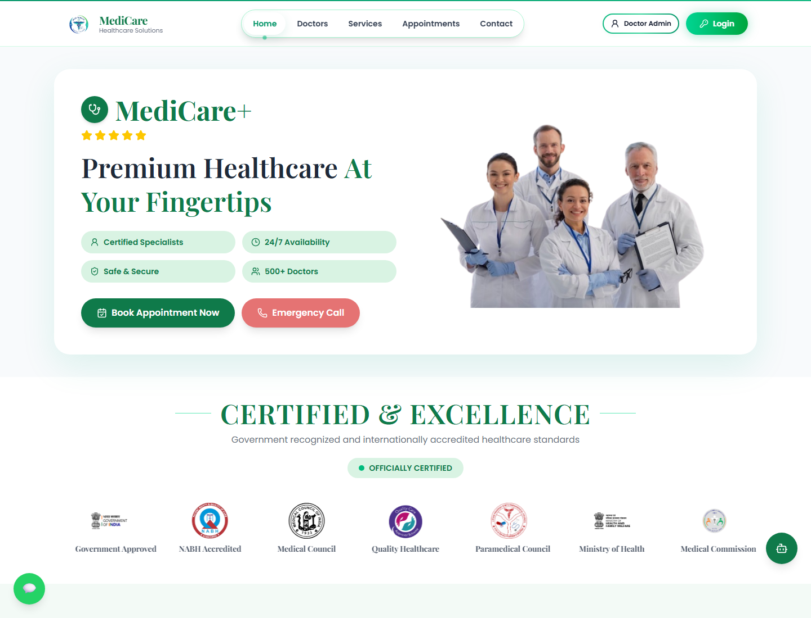
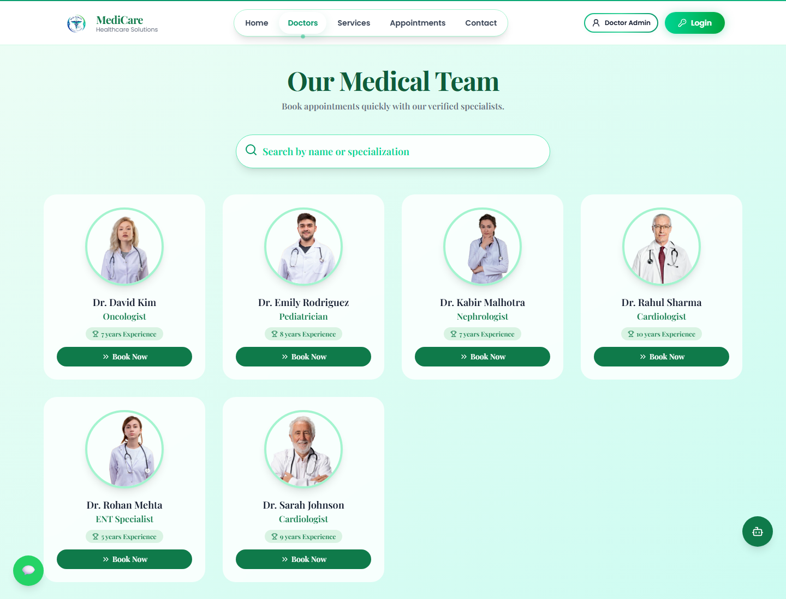
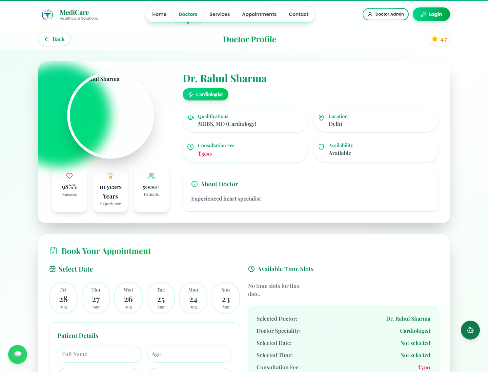
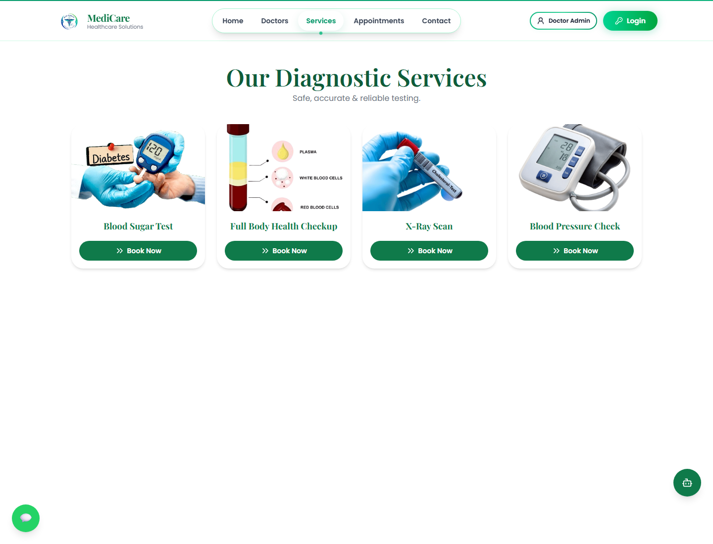
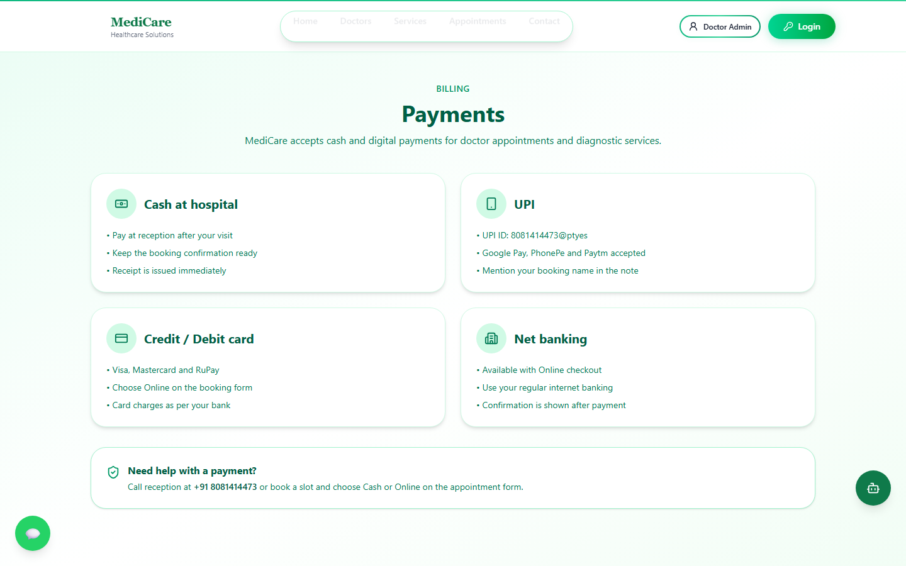
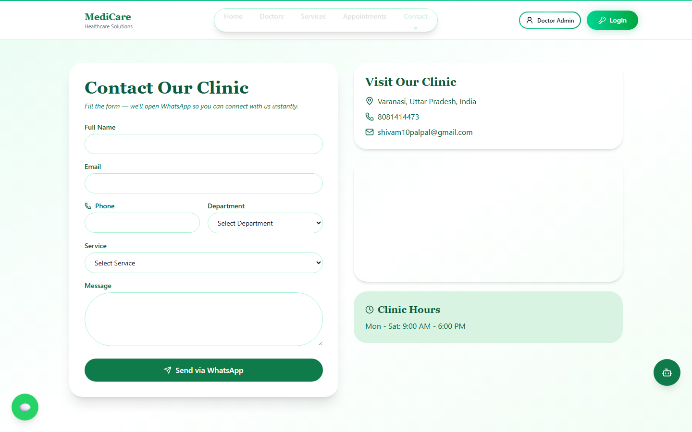
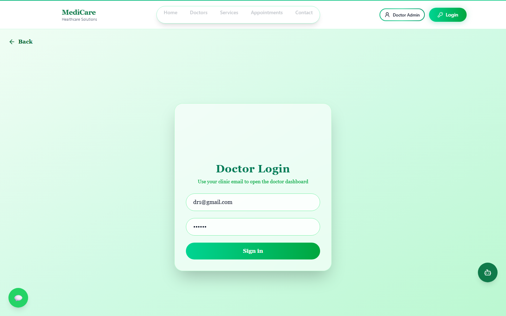

<p align="center">
  
</p>

<h1 align="center">MediCare — Distributed Healthcare & Appointment Platform</h1>

<p align="center">
  Production-grade hospital appointment & diagnostic booking system built on a <strong>Hybrid Microservices Mesh</strong> with <strong>Redlock Distributed Locking</strong>, <strong>Multi-Tier L1/L2 Caching</strong>, <strong>Idempotent Transactions</strong>, <strong>Circuit Breakers</strong>, and an <strong>Async Event Bus</strong>.
</p>

<p align="center">
  <a href="https://medi-care-two-blush.vercel.app"></a>
  <a href="https://medi-care-two-blush.vercel.app/system-status"></a>
  <a href="https://github.com/Shivampal157/MediCare"></a>
  <a href="https://medicare-api-36hv.onrender.com/api/health"></a>
</p>

<p align="center">
  
  
  
  
  
  
  
  
  
  
  
</p>

<p align="center">
  
</p>

---

## Live Links & Endpoints

| Resource | URL |
| --- | --- |
| **Live Patient Portal** | [medi-care-two-blush.vercel.app](https://medi-care-two-blush.vercel.app) |
| **Live Distributed Service Mesh UI** | [medi-care-two-blush.vercel.app/system-status](https://medi-care-two-blush.vercel.app/system-status) |
| **API Gateway Health Probe** | [medicare-api-36hv.onrender.com/api/health](https://medicare-api-36hv.onrender.com/api/health) |
| **Distributed Topology & Telemetry JSON** | [medicare-api-36hv.onrender.com/api/system/architecture](https://medicare-api-36hv.onrender.com/api/system/architecture) |
| **Hospital Location** | Varanasi, Uttar Pradesh |

---

## Distributed Systems Architecture

MediCare is engineered using a **Hybrid Microservices Mesh** that runs either as a **multi-container cluster** (`docker compose up` with Nginx Load Balancer, API Gateway, 4 domain microservices, Redis, and MongoDB) or as a **single-node modular gateway** on Render with automatic in-process failover.

```text
  Patient Site (Vercel)          Doctor Dashboard            Admin Panel
           |                            |                         |
           +------------------- HTTPS / REST ---------------------+
                                        |
                         Nginx Load Balancer (:8080)
                                        |
                Smart API Gateway & Control Plane (:4000)
          [Tracing • Sliding-Window Rate Limiter • Idempotency]
                                        |
        +-----------------------+-------+---------------+-----------------------+
        |                       |                       |                       |
  Catalog Service        Booking Service        AI Triage Service      Notification Worker
     (:4001)                 (:4002)                 (:4003)                 (:4004)
  [Cache-Aside]        [Redlock + Fencing]      [Circuit Breaker]       [Event Bus + DLQ]
        |                       |                       |                       |
        +-----------+-----------+-----------+-----------+-----------------------+
                    |                       |                       |
             Redis Cluster            MongoDB Atlas          External APIs
         (L2 Cache & Mutex Locks)   (+ Resilient Store)    (Gemini / Stripe)
```

### Microservices Decomposition (`backend/services/`)

| Service | Port | Entrypoint | Core Responsibilities |
| --- | --- | --- | --- |
| **API Gateway** | `:4000` | `backend/server.js` | Edge routing (`proxyRouter.js`), distributed request tracing (`X-Correlation-Id`), sliding-window rate limiting, idempotency enforcement, and control-plane telemetry (`/api/system/*`). |
| **Catalog Service** | `:4001` | `backend/services/catalogService.js` | Manages Doctor profiles, dynamic slot schedules, and Diagnostic Lab Services with **L1/L2 Cache-Aside** (`X-Cache: HIT \| MISS`). |
| **Booking Service** | `:4002` | `backend/services/bookingService.js` | Concurrency-safe appointment & lab booking engine protected by **Redlock Distributed Mutex Locks**, **Monotonic Fencing Tokens**, and **Stripe Checkout**. |
| **AI Triage Service** | `:4003` | `backend/services/aiTriageService.js` | Bilingual (Hindi/English) symptom-to-department clinical navigation powered by Google Gemini and protected by a **Circuit Breaker** (`CLOSED` → `OPEN` → `HALF_OPEN`) with deterministic local triage fallback. |
| **Notification Worker** | `:4004` | `backend/services/workerService.js` | Asynchronous Pub/Sub event consumer (`appointment.created`, `catalog.doctor.updated`, etc.) handling cross-node cache invalidation, audit logging, and exponential backoff retries with a **Dead-Letter Queue (DLQ)**. |

---

### Core Distributed Engineering Guarantees (`backend/distributed/`)

1. **Zero Double-Booking under High Concurrency (`lockManager.js`)**
   - When multiple patients attempt to book the exact same doctor (`doctorId`) on the same `date` and `time` simultaneously, the Booking Service acquires a distributed mutex lock on `slot:doctor:<doctorId>:<date>:<time>` with a monotonic **Fencing Token** (`X-Fencing-Token`).
   - Only one request enters the critical section and commits the slot; concurrent conflicting requests receive `HTTP 409 Conflict` (`SLOT_LOCK_CONTENTION` / `SLOT_ALREADY_BOOKED`).
   - **Interactive Verification:** Visit `/system-status` and click **"Simulate 8 Concurrent Bookings"** (or `POST /api/system/simulate-concurrency`) to fire 8 parallel booking requests at the same millisecond and verify that exactly `1` succeeds while `7` race conditions are blocked.

2. **At-Most-Once Idempotent Mutations (`idempotency.js`)**
   - Supports client-supplied `Idempotency-Key` headers as well as automatic SHA-256 request payload fingerprinting on `POST /api/appointments` and `POST /api/service-appointments`.
   - Network retries or accidental double-clicks replay the cached response with `X-Idempotent-Replay: true` without creating duplicate bookings or duplicate Stripe Checkout sessions.

3. **Multi-Tier Distributed Caching (`cache.js`)**
   - Combines an in-memory **L1 LRU Cache** with an optional **L2 Redis Cache** (`REDIS_URL` via native TCP RESP protocol).
   - Read-heavy catalog and analytics endpoints (`GET /api/doctors`, `GET /api/services`, `GET /api/appointments/stats`) serve cached responses in `<2ms` and automatically invalidate stale prefixes when domain events are published to the Event Bus.

4. **Circuit Breakers & Graceful Degradation (`circuitBreaker.js` & `resilientStore.js`)**
   - External calls to **Google Gemini AI**, **Stripe Checkout**, and **Cloudinary** are wrapped in isolated state machines (`CLOSED` → `OPEN` → `HALF_OPEN`) with timeout guards.
   - **Zero-Downtime Cold Starts & DB Failover:** On the frontend, **Stale-While-Revalidate (SWR)** (`fallbackCatalog.js`) renders doctors and diagnostic services in `0ms` while syncing with the live API in the background. On the backend, if MongoDB Atlas is paused or unreachable, `resilientStore.js` automatically serves requests from a seeded in-memory document store so the server never crashes.

5. **Distributed Tracing & Observability Headers (`tracing.js`)**
   - Every HTTP response exposes real-time distributed telemetry headers:
     - `X-Request-Id` & `X-Correlation-Id` — End-to-end trace correlation across microservices
     - `X-Served-By` & `X-Microservice` — Instance node ID and handling microservice
     - `X-Response-Time-Ms` — High-resolution execution latency (tracked in live `p50`, `p95`, `p99` histograms)
     - `X-Cache` & `X-Cache-Tier` — `HIT` / `MISS` and `L1-MEMORY` / `L2-REDIS`
     - `X-Fencing-Token` & `X-Idempotency-Key` — Concurrency and idempotency verification tokens

---

## Product Tour

### Homepage

Hero, certifications, and a one-click path to booking. WhatsApp and the green **MediCare AI** button stay on every public page.

<p align="center">
  
</p>

### Find a Doctor

Search by name or specialization. Each card opens a profile with fee, availability, and **Book Now**.

<p align="center">
  
</p>

### Doctor Profile & Concurrency-Safe Booking

Qualifications, fee, success stats, date picker, patient form, and a live booking summary protected by `Idempotency-Key` and Redlock slot locking.

<p align="center">
  
</p>

### Diagnostic Services

Blood sugar, full-body checkup, X-ray, BP check — same booking flow as doctors.

<p align="center">
  
</p>

### Payments

Cash at hospital, UPI, cards, and net banking. UPI ID is shown on the site.

<p align="center">
  
</p>

### Contact

Form opens WhatsApp with the clinic. Address, phone, email, and hours on the right.

<p align="center">
  
</p>

### Doctor Login

Separate dashboard for appointments and profile. Demo: `dr1@gmail.com` / `123456`.

<p align="center">
  
</p>

---

## What You Can Do in the App

| Role | Features |
| --- | --- |
| **Patient** | Google sign-in, browse doctors & lab tests, book concurrency-safe slots, pay via cash or Stripe online checkout, use Gemini AI triage chat, WhatsApp integration |
| **Doctor** | JWT login, view/manage patient appointments, edit profile, fees, and slot schedule |
| **Admin** | Add / edit doctors and diagnostic services, monitor appointment and service revenue |
| **System Engineer** | Inspect live microservice mesh topology, cache hit ratio, circuit breakers, event bus stream, and run 8-way concurrency simulations at `/system-status` |

---

## Tech Stack

| Layer | Technology |
| --- | --- |
| **Frontend** | React 19, Vite, Tailwind CSS, Lucide Icons, SWR Fallback Catalog |
| **API Gateway & Services** | Node.js, Express, Smart Proxy Router (`proxyRouter.js`) |
| **Distributed Primitives** | Redlock Mutex + Fencing Tokens, L1 LRU + L2 Redis Cache, Idempotency Engine, Circuit Breakers, Async Event Bus + DLQ, Sliding-Window Rate Limiter |
| **Database & Storage** | MongoDB Atlas + Mongoose + Zero-Downtime Resilient In-Memory Store |
| **Container Orchestration** | Docker, Docker Compose (`docker-compose.yml`), Nginx Load Balancer (`nginx/nginx.conf`), Redis 7 |
| **Auth & Payments** | Google Sign-In (patients), bcrypt + JWT (doctors), Stripe Checkout + Cash/UPI |
| **AI Assistant** | Google Gemini (`GEMINI_API_KEY`) + Local Clinical Rule-Based Triage Fallback |
| **Cloud Deployment** | Vercel (Frontend) + Render (API Gateway) |

---

## Demo Login

| Role | Credentials |
| --- | --- |
| **Patient** | **Continue with Google**, or `patient@gmail.com` / `123456` |
| **Doctor** | `dr1@gmail.com` / `123456` at `/login` → `/doctor-admin` |
| **Sample Diagnostic Service** | Full Body Health Checkup (`₹999`) |

---

## Run Locally

```bash
cp backend/.env.example backend/.env
cp frontend/.env.example frontend/.env
```

### Option A: Hybrid Gateway Mode (Single Command)

Runs the API Gateway and all microservices in-process with L1 LRU caching, Redlock slot locking, circuit breakers, and automatic database fallback:

```bash
# 1. Start Distributed API Gateway  →  http://localhost:4000
cd backend && npm install && npm run dev

# 2. Start Patient Portal           →  http://localhost:5173
cd frontend && npm install && npm run dev

# 3. Start Admin Panel (optional)   →  http://localhost:5174
cd admin && npm install && npm run dev
```

### Option B: Full Multi-Container Microservices Cluster (Docker Compose)

Spins up **Nginx Load Balancer (`:8080`)**, **API Gateway (`:4000`)**, **Catalog Service (`:4001`)**, **Booking Service (`:4002`)**, **AI Triage Service (`:4003`)**, **Notification Worker (`:4004`)**, **Redis 7 (`:6379`)**, and **MongoDB 7 (`:27017`)**:

```bash
docker compose up --build
```

### Verify Distributed Endpoints

- **Gateway Health:** `GET http://localhost:4000/api/health`
- **Service Mesh & Telemetry:** `GET http://localhost:4000/api/system/architecture`
- **Event Bus & DLQ Stream:** `GET http://localhost:4000/api/system/events`
- **8-Way Concurrency Lock Test:** `POST http://localhost:4000/api/system/simulate-concurrency`
- **Interactive UI Dashboard:** `http://localhost:5173/system-status`

---

## Environment Variables

**Backend** (`backend/.env`)

| Variable | Purpose |
| --- | --- |
| `MONGODB_URI` | MongoDB Atlas URI (`.../medicare`) |
| `REDIS_URL` | Optional L2 Redis URI (`redis://localhost:6379`) |
| `JWT_SECRET` | Doctor JWT signing secret |
| `FRONTEND_URL` | Patient site origin (CORS + Stripe redirects) |
| `ADMIN_URL` | Admin site origin (CORS) |
| `PORT` | Gateway port (default `4000`) |
| `GEMINI_API_KEY` | Google Gemini API key for MediCare AI triage |
| `CATALOG_SERVICE_URL` | Optional upstream URL for standalone Catalog microservice |
| `BOOKING_SERVICE_URL` | Optional upstream URL for standalone Booking microservice |
| `AI_SERVICE_URL` | Optional upstream URL for standalone AI Triage microservice |

Optional: `STRIPE_SECRET_KEY`, `CLOUDINARY_CLOUD_NAME`, `CLOUDINARY_API_KEY`, `CLOUDINARY_API_SECRET`.

**Frontend** (`frontend/.env`)

| Variable | Purpose |
| --- | --- |
| `VITE_API_URL` | Backend Gateway URL (`http://localhost:4000` or Render URL) |
| `VITE_GOOGLE_CLIENT_ID` | Google OAuth Web Client ID |
| `VITE_PHONE` / `VITE_EMAIL` / `VITE_UPI_ID` / `VITE_LOCATION` | Hospital contact & UPI details |

---

## Author

**Shivam Pal** — IIIT Agartala, CSE  
[GitHub](https://github.com/Shivampal157) · [LinkedIn](https://www.linkedin.com/in/shivam-pal-677777301)
